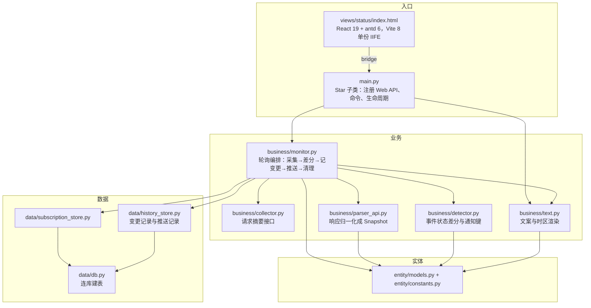

# OpenAI 服务整体状态监控与订阅

Feature Name: openai-status-monitor
Updated: 2026-10-21

## Description

本设计实现 `specs/openai-status-monitor/requirements.md` 中的 11 条需求：每轮只请求状态页的摘要接口，把 `ongoing_incidents` 与 `scheduled_maintenances` 合并成事件列表，逐条比较 `status`，把新出现与状态变化合并成一条通知推给订阅群，并为每条变化写一行变更记录；整体状态（进行中事件或非正常组件非空即异常）仍用于命令与页面。提供 `oaistatus` 命令、订阅管理页面与变更记录页面。状态页的组件图、更新时间线、90 天可用性、Atom/RSS 都不在范围内。

不在范围内：向 OpenAI 提交任何数据、调用状态页的订阅接口、解析 HTML、对 `api.openai.com` 做真实拨测、请求 `/incidents` 历史列表。

## 数据源事实（2026-10-21 实测）

摘要接口 `GET https://status.openai.com/proxy/status.openai.com` 返回 `{"summary": {...}}`，页面无登录，国内网络可直连。摘要主要字段：

| 字段 | 说明 |
|---|---|
| `id` / `name` / `subpath` / `public_url` | 状态页标识 |
| `components[]` | 全部组件，只有 `id` / `name` / `status_page_id`，**没有 status** |
| `structure.items[]` | 分组树；本插件不读 |
| `affected_components[]` | 当前非正常组件，元素 `{component_id, status}` |
| `ongoing_incidents[]` | 进行中事件，实测结构与历史事件相同 |
| `scheduled_maintenances[]` | 计划维护，元素结构与事件相同，`type=maintenance` |

事件对象实测字段：`id`（ULID）、`name`、`status`、`type`、`published_at`、`affected_components[]`、`component_impacts[]`、`status_summaries[]`、`updates[]`。`updates[]` 每条含 `id`、`published_at`、`to_status`、`message_string`、`component_statuses[]`。

实测样本：

- 2026-10-21 摘要有一条 `identified` 的 FedRAMP 故障，`affected_components` 有一条 `degraded_performance`；`scheduled_maintenances` 为空。
- `scheduled_maintenances` 在 OpenAI 状态页当时没有样本，改取同一 incident.io 产品的 `https://status.supabase.com/proxy/status.supabase.com`：元素 `type=maintenance`、`status=maintenance_scheduled`、`component_impacts=[]`、`affected_components=[]`，**没有 `start_at` / `end_at`**。
- 该站历史里维护状态按 `maintenance_scheduled → maintenance_in_progress → maintenance_complete` 推进。
- 页面 JS bundle 的状态枚举为：故障 `investigating` / `identified` / `monitoring` / `resolved`；维护 `maintenance_scheduled` / `maintenance_in_progress` / `maintenance_complete`；类型 `incident` / `maintenance`。
- 页面 bundle 里维护窗口显示取 `component_impacts[].start_at` 的最小值与 `end_at` 的最大值；但摘要里的维护样本 `component_impacts` 为空，不能据此判断当前是否生效。

由此确定：**整体状态按 `status` 判断，不按 `start_at` / `end_at` 判断**。`maintenance_in_progress` 计入异常；`maintenance_scheduled` 只作为未来维护，整体仍正常；`maintenance_complete` 与 `resolved` 算已结束。

组件状态实测：`degraded_performance`、`partial_outage`、`full_outage`。`affected_components` 只列当前非正常组件，非空时也把整体状态按异常处理。

事件详情页 `https://status.openai.com/incidents/{id}` 实测 200。历史接口 `/incidents` 约 620 KB，不用于轮询。

## Architecture

依赖单向：`main.py` → `business/` → `data/`；`entity/` 不依赖 AstrBot，也不访问数据库。

一次轮询的顺序：

1. `GET /proxy/status.openai.com`，成功则解析出 `Snapshot`（含进行中事件与计划维护）。
2. 逐条比较事件：新出现或 `status` 取值变化记一条变化；上一轮有、本轮消失不算；首次采集只建基线。
3. 有变化时先为每条变化写一行变更记录，再把本轮所有变化合并成一条通知；变更记录写入失败则本轮不推送、不替换快照。
4. 推送 → 逐群写推送结果。
5. 按保留天数清理变更记录与推送记录。

关键约定：

- 插件数据目录用 `StarTools.get_data_dir(PLUGIN_NAME)` **显式传插件名**；从 `data/db.py` 子模块调用不传名会抛 `RuntimeError`。
- 页面目录用官方首选名 `views/`，只做 **一个视图** `views/status/`，页内 antd `Tabs` 切换「概览与配置 / 订阅管理 / 变更记录」，不改顶层 hash。
- 轮询用 `asyncio` 后台任务，在 `initialize()` 启动、`terminate()` 取消，不引入 `apscheduler`。
- 接口根地址、事件详情前缀写成实体常量；状态页迁移时只改一处。

## Components and Interfaces

### 实体层 `entity/`

`entity/constants.py`

| 名字 | 含义 |
|---|---|
| `PLUGIN_NAME` | `"astrbot_plugin_openai_status"` |
| `STATUS_PAGE_BASE` | `"https://status.openai.com"` |
| `API_BASE` | `"https://status.openai.com/proxy/status.openai.com"` |
| `REQUEST_TIMEOUT_SECONDS` | `10` |
| `CLOSED_EVENT_STATUSES` | `{"resolved", "maintenance_complete"}` |
| `UPCOMING_EVENT_STATUSES` | `{"maintenance_scheduled"}` |
| `NOTIFY_CHANGES` / `NOTIFY_SUMMARY` | 一轮变化汇总 / 订阅确认摘要 |
| `STATUS_LABELS` | 七种状态的中文映射 |
| `EVENT_TYPE_LABELS` | `incident` 故障、`maintenance` 计划维护 |
| `COMMAND_NAME` | `"oaistatus"`：默认指令名 |
| `DEFAULT_TIMEZONE` | `ZoneInfo("Asia/Shanghai")` |

`entity/models.py`：

- `StatusEvent`：`change_id: str`（ULID）、`change_type`、`title`、`status`、`link`、`components: list[str]`（组件名）、`message: str`（最新进展）。
- `Snapshot`：`status`（`normal` / `abnormal`）、`events`（进行中事件与计划维护）、`fetched_at`。
- `Subscription`：`id`、`session`、`note`、`enabled`、`created_at`、`updated_at`。
- `Notification`：`notify_type`、`dedup_key`、`message`。
- `MonitorConfig`：五个配置字段，由入口层从原始 dict 转换后注入 `Monitor`。

### 数据层 `data/`

`data/db.py`

- `get_db_path() -> Path`：`StarTools.get_data_dir(PLUGIN_NAME) / "openai_status.db"`。
- `connect(db_path) -> sqlite3.Connection`：行工厂 + WAL。
- `init_db(conn) -> None`：建三张表（`CREATE TABLE IF NOT EXISTS`）。
- `utc_now() -> str`：UTC ISO8601 带 `Z`。

`data/subscription_store.py`：`list_subscriptions`、`get_by_session`、`get_by_id`、`enable_session`、`disable_session`、`create`、`update`、`delete`；与 DeepSeek 插件一致。

`data/history_store.py`

- `record_change(conn, event, fetched_at) -> int`：写一行；组件列表用 JSON 文本存。
- `list_changes(conn, page, size) -> tuple[list[dict], int]`：按采集时间倒序分页；读出时把组件 JSON 还原成数组。
- `record_push(...)`：写一条推送结果（成功/失败、原因与原始报错）和消息正文。
- `purge_expired(conn, retention_days) -> int`：删超过保留天数的变更与推送记录。

### 业务层 `business/`

`business/collector.py`

- `class CollectorError(Exception)`：请求层失败（超时、非 200、非法 JSON）。
- `api_url(path: str) -> str`：`API_BASE + path`；空路径即摘要接口。
- `make_timeout()`：10 秒 `aiohttp.ClientTimeout`，延迟导入 aiohttp。
- `async fetch_summary() -> dict`：GET 并返回 `payload["summary"]`；非 200 / 非法 JSON 抛 `CollectorError`，缺 `summary` 抛 `ValueError`。

`business/parser_api.py`

- `event_link(change_id: str) -> str`：`https://status.openai.com/incidents/{id}`。
- `component_name_map(summary: dict) -> dict[str, str]`：组件 ID → 名称，坏条目跳过。
- `parse_event(item: dict, names: dict[str, str]) -> StatusEvent`：ID 必须是非空字符串、状态必须是非空字符串，否则抛 `ValueError`；组件名映射不到时保留 ID；最新进展取 `updates[]` 里 `published_at` 最大的 `message_string`。
- `parse_snapshot(summary: dict, fetched_at: str) -> Snapshot`：两个事件数组都必须是列表；按 ID 去重；进行中事件或 `affected_components` 非空即 `abnormal`。

`business/detector.py`

- `detect_event_changes(previous, current) -> list[StatusEvent]`：按 `change_id` 比对，新出现（已结束除外）或 `status` 不同即变化；消失忽略。
- `changes_key(snapshot) -> str`：`f"changes:{snapshot.fetched_at}"`。

`business/text.py`

- `resolve_timezone(raw)` / `to_local(fetched_at, tz)`。
- `render_changes(changes, fetched_at, tz)`：汇总通知；每条列标题、类型、状态、组件、最新进展与链接；正文压成一行并截断到 200 字。
- `render_summary(snapshot, tz)`：正常一句状态；异常列进行中事件；计划维护单独列出。
- `render_status_reply(snapshot, tz)` / `render_help(command_name)`。

`business/monitor.py`

- `Monitor`：持有 `conn`、`config`、`context`、内存快照与轮询任务。
- `start` / `stop` / `run`：起停与节拍控制，单轮异常只记日志。
- `_tick`：采集 → 差分 → 写变更记录 → 推送 → 换快照 → 清理。
- `_collect`：请求失败与结构异常分别记日志并返回 `None`。
- `_dispatch`：逐群发送，相邻间隔 1 秒；单条失败继续。
- `push_summary(session) -> bool`：开启订阅时主动查一次，推“OpenAI 状态监控已开启…”前缀 + 当前状态。
- `snapshot()`：供命令与页面读取。

### 入口层 `main.py`

- `Plugin(Star)`：建库、转换配置、创建 `Monitor`、注册 9 条 Web API；`initialize()` 启动轮询，`terminate()` 停止并关连接。
- 平台发现：`_onebot_platform` 用 `bot.call_action` 识别 OneBot 实例，不按平台名写死；`_normalize_session` 把 UMO 前缀改成 `meta().id`，启动时迁移旧订阅。
- `async def oaistatus(self, event, sub="")`：只处理群聊，私聊直接忽略并 `stop_event()`；子命令「开 / 关 / 帮助」；帮助与未知子命令用实际触发的首个 token；所有分支结束调用 `stop_event()`。
- Web API 路由：

| 方法 | 路由 | 处理函数 | 说明 |
|---|---|---|---|
| GET | `/{PLUGIN}/settings` | `page_get_settings` | 读五项非密钥配置 |
| POST | `/{PLUGIN}/settings/save` | `page_save_settings` | 写回配置并 `save_config()` |
| GET | `/{PLUGIN}/status` | `page_get_status` | 当前快照（含组件与最新进展） |
| GET | `/{PLUGIN}/subscriptions` | `page_list_subscriptions` | 订阅列表 |
| POST | `/{PLUGIN}/subscriptions` | `page_create_subscription` | 新增订阅 |
| POST | `/{PLUGIN}/subscriptions/<sub_id>/update` | `page_update_subscription` | 编辑订阅 |
| POST | `/{PLUGIN}/subscriptions/<sub_id>/delete` | `page_delete_subscription` | 删除订阅 |
| GET | `/{PLUGIN}/history` | `page_list_changes` | 变更记录分页 |
| GET | `/{PLUGIN}/group-name` | `page_get_group_name` | 按群号取群名 |

> 页面 bridge 只提供 `apiGet` / `apiPost`，写操作统一用 POST。

### 前端 `dashboard/` 与 `views/status/`

技术栈按 ai-kit 默认技术栈：React 19 + antd 6 + TypeScript 7 + Vite 8，构建用 Node 24；不引 Tailwind。

| 文件 | 作用 |
|---|---|
| `dashboard/index.html` | 挂载点 `#root`；标题与 bridge SDK |
| `dashboard/vite.config.ts` | `base: "./"`、`outDir: "../views/status"`、单份 IIFE、去 `type="module"` |
| `dashboard/src/main.tsx` | `StyleProvider layer` 包住应用 |
| `dashboard/src/App.tsx` | `ConfigProvider` + antd `Tabs` 承载三个视图 |
| `dashboard/src/status-view.tsx` | 概览与配置：状态卡 + 五字段表单，打开/刷新/保存后请求 |
| `dashboard/src/status-card.tsx` | 正常 / 异常 / 无数据 / 关闭四态，列出进行中事件与计划维护 |
| `dashboard/src/subscriptions-view.tsx` | 列表、即时开关、新增/编辑/删除、按群号拉群名 |
| `dashboard/src/changes-view.tsx` | 服务端分页，列含组件与最新进展 |
| `dashboard/src/bridge.ts` | 封装 bridge；开发模式用同形假数据 |

构建命令 `cd dashboard && pnpm build`，产物 `views/status/index.html` + `assets/index.js` + `assets/style.css` 提交进仓库。

## Data Models

### `_conf_schema.json`（非密钥，全部出现在配置页）

| 字段 | 类型 | 默认 | 约束 |
|---|---|---|---|
| `enabled` | bool | `false` | 监控总开关 |
| `poll_interval_seconds` | int | `60` | 30 至 3600 |
| `notify_enabled` | bool | `true` | 通知推送开关 |
| `history_retention_days` | int | `30` | 1 至 365 |
| `display_timezone` | string | `"Asia/Shanghai"` | IANA 时区名 |

### 内存结构

- `Snapshot`：`status`、`events`（进行中事件与计划维护，已结束条目也保留供差分）、`fetched_at`。
- 启动后首次采集只建基线，不写变更记录、不发通知。

### SQLite（`data/plugin_data/astrbot_plugin_openai_status/openai_status.db`）

`subscriptions`

| 列 | 类型 | 说明 |
|---|---|---|
| `id` | INTEGER PRIMARY KEY AUTOINCREMENT | 主键 |
| `session` | TEXT NOT NULL UNIQUE | `unified_msg_origin` |
| `note` | TEXT NOT NULL DEFAULT '' | 备注名（群名） |
| `enabled` | INTEGER NOT NULL DEFAULT 1 | 启用开关 |
| `created_at` / `updated_at` | TEXT NOT NULL | UTC ISO8601 带 `Z` |

`change_log`

| 列 | 类型 | 说明 |
|---|---|---|
| `id` | INTEGER PRIMARY KEY AUTOINCREMENT | 主键 |
| `change_id` | **TEXT** NOT NULL | 状态页事件 ID（ULID） |
| `change_type` | TEXT NOT NULL | `incident` / `maintenance` |
| `title` | TEXT NOT NULL | 事件标题 |
| `status` | TEXT NOT NULL | 变化后的状态值 |
| `components` | TEXT NOT NULL DEFAULT '[]' | 组件名 JSON 数组 |
| `message` | TEXT NOT NULL DEFAULT '' | 最新进展正文 |
| `fetched_at` | TEXT NOT NULL | 采集时间，UTC ISO8601 带 `Z` |

`push_records`

| 列 | 类型 | 说明 |
|---|---|---|
| `id` | INTEGER PRIMARY KEY AUTOINCREMENT | 主键 |
| `session` | TEXT NOT NULL | 群会话标识 |
| `dedup_key` | TEXT NOT NULL | 一轮通知的去重键 |
| `notify_type` | TEXT NOT NULL | `changes` / `summary` |
| `message` | TEXT NOT NULL | 已渲染的消息正文 |
| `result` | TEXT NOT NULL | `ok` / `failed` |
| `error` | TEXT NOT NULL DEFAULT '' | 失败原因与原始报错 |
| `created_at` | TEXT NOT NULL | 推送完成时间 |
| 唯一约束 | `UNIQUE(session, dedup_key)` | 同会话同通知只留一条 |

## Correctness Properties

- **P1 基线不刷屏**：进程启动后的首次成功采集只建基线，不写变更记录、不产生任何推送。
- **P2 只在事件状态变化时通知**：新出现（已结束除外）或 `status` 变化的事件合并成一条通知；上一轮有、本轮消失不通知；整体翻转不单独通知。
- **P3 去重幂等**：一轮通知的键为 `changes:<采集时间>`，同一会话同一键只留一条推送记录。
- **P4 不重试**：推送失败只写入运行日志与推送记录，不在下一轮重发。
- **P5 快照一致**：变更记录写入成功后才推送与替换内存快照；写入失败则本轮不推送、不替换。
- **P6 时间一致**：数据库时间列统一 UTC ISO8601 带 `Z`；推送与命令回复按配置时区渲染，页面按浏览器本地时区渲染。
- **P7 ULID 不转整数**：事件 ID 从解析到 SQLite 全程是字符串；`change_log.change_id` 是 TEXT。

## Error Handling

| 场景 | 处理 |
|---|---|
| 请求超时、非 200、响应不是合法 JSON | 保留上一份快照，记 warning「请求失败」并附原因，不生成通知 |
| 200 但缺 `summary` / 两个事件数组不是数组 / 事件缺 ID 或状态 | 保留上一份快照，记 warning「接口结构异常」并附字段名，不生成通知 |
| 组件表缺失或条目坏 | 跳过坏条目；组件名映射不到时显示组件 ID |
| 采集成功 | 有变化时先写变更记录，再推送与替换快照 |
| 变更记录写入失败 | 记 `error` 日志，本轮不推送、不替换快照 |
| 单群推送失败 | 记 `failed`、原因与原始报错，继续处理其余群，不重试 |
| 会话标识失效（`send_message` 返回 `False`） | 记 `failed`，保留推送记录供排查，不自动停用订阅 |
| 命令子命令不识别、快照为空 | 回复帮助文案或「暂无状态数据」，不抛异常 |
| 群名拉取失败 | 订阅仍开启，备注保持为空 |
| 页面接口收到非对象请求体、非法 `sub_id` 或非法时区 | 返回 400 与中文错误信息 |
| 配置的展示时区不是合法 IANA 名称 | 运行时回退 `DEFAULT_TIMEZONE` 并记 warning；页面保存返回 400 |

## Test Strategy

单元测试全部走 `python3 -m unittest`，不连网络、不连真实 AstrBot，也不导入 `astrbot` 包。当前 138 个用例（真实网络 1 条默认 skip）。

| 测试文件 | 覆盖内容 |
|---|---|
| `tests/test_scaffold.py` | 目录、metadata、五个配置字段与取值范围 |
| `tests/test_entity.py` | 常量（含维护状态）、ULID 事件与组件/正文字段 |
| `tests/test_parser_api.py` | 三份实测 fixture（正常、进行中故障、计划维护）、组件映射、最新进展、去重、结构错误 |
| `tests/test_detector.py` | 新出现、状态变化、计划维护通知、消失不报、首次为空、重复 ID |
| `tests/test_stores.py` | 临时目录 SQLite：订阅增删改、变更记录（含组件 JSON）、分页、推送结果、清理 |
| `tests/test_text.py` | 时区回退、时间渲染、变化汇总（组件/进展/截断）、摘要与计划维护、帮助用实际指令名 |
| `tests/test_collector.py` | 摘要地址、超时、非 200、非法 JSON、缺 summary、连接失败 |
| `tests/test_monitor.py` | 基线不推送、同轮合并、消失不推、记录写失败不推送、逐群间隔与失败继续、摘要推送 |
| `tests/test_main.py` | 9 条路由、配置校验、命令四个分支、私聊忽略、平台 ID 迁移、状态接口字段 |

fixture：

- `tests/fixtures/summary_live.json`：2026-10-21 实测，含一条 `identified` 故障与一个非正常组件。
- `tests/fixtures/summary_maintenance.json`：同一 incident.io 产品的真实计划维护样本（从 `status.supabase.com` 摘要裁剪）。
- `tests/fixtures/summary_normal.json`：同一接口的正常态最小样本。

真实网络验证写成默认 `skip` 的用例，设 `OPENAI_STATUS_LIVE=1` 时才执行。

页面验收：`tsc --noEmit` 通过；产物为单份 IIFE；HTML 只引用 `./assets/index.js`（`script defer`）与 `./assets/style.css`；三个 Tab 可切换且不改 hash；配置保存生效；启用订阅立即收到摘要。

## 决策与待确认事项

1. **事件 ID 用 TEXT**：ULID 字符串从解析到库表全程不转整数（2026-10-21 定）。
2. **维护按状态判定，不按时间**：实测 `scheduled_maintenances` 没有 `start_at` / `end_at`，`component_impacts` 也可能为空；只有 `maintenance_in_progress` 计入异常（2026-10-21 与用户确认）。
3. **计划维护要通知**：`maintenance_scheduled` 新出现时按新事件通知，但整体状态仍正常（2026-10-21 与用户确认）。
4. **通知带组件名与最新进展**：组件 ID 用 `summary.components` 映射；最新进展取最新 `updates[].message_string`（2026-10-21 与用户确认）。
5. **整体状态用 `affected_components` 辅助**：进行中事件为空但组件非正常时仍按异常展示。
6. **不用历史列表**：`/incidents` 约 620 KB，不放进轮询；变更记录由插件自己记。
7. **指令名 `oaistatus`**：改名走 AstrBot「指令管理」，插件只在注册时用默认名。
8. **一个视图三个 Tab**：概览与配置 / 订阅管理 / 变更记录。
9. **展示时区用 IANA 名称**：非法值运行时回退 `Asia/Shanghai`，页面保存返回 400。
10. **只支持 OneBot 群聊**：平台用 `bot.call_action` 识别；UMO 前缀重写成 `meta().id`；旧订阅启动时迁移。
11. **URL 前缀集中成常量**：`API_BASE` 与 `STATUS_PAGE_BASE` 各一处；代理地址变化时只改实体层。

## References

[^1]: [OpenAI 官方状态页](https://status.openai.com/)
[^2]: [ai-kit：OpenAI 状态页监控 API 文档](https://github.com/w1ndys/ai-kit/blob/main/docs/openai-status-api.md)
[^3]: [incident.io 状态页 API](https://docs.incident.io/status-pages/api)
[^4]: [StarTools.get_data_dir 的插件名解析](https://github.com/AstrBotDevs/AstrBot/blob/master/astrbot/core/star/star_tools.py)
[^5]: [Context.register_web_api](https://github.com/AstrBotDevs/AstrBot/blob/master/astrbot/core/star/context.py)
[^6]: [插件可视化视图放在 views/ 下](https://github.com/AstrBotDevs/AstrBot/blob/master/docs/zh/dev/star/guides/plugin-pages.md)
[^7]: [主动消息与 unified_msg_origin](https://github.com/AstrBotDevs/AstrBot/blob/master/docs/zh/dev/star/guides/send-message.md)
[^8]: [插件 Web API 的 request / json_response / error_response](https://github.com/AstrBotDevs/AstrBot/blob/master/astrbot/api/web.py)
[^9]: [ai-kit：时间存 UTC，展示层换算](https://github.com/w1ndys/ai-kit/blob/main/docs/dev-conventions.md)
[^10]: [业务数据放 data/plugin_data/{plugin_name}/](https://github.com/AstrBotDevs/AstrBot/blob/master/docs/zh/dev/star/guides/storage.md)
[^11]: [本功能需求文档](requirements.md)
[^12]: [参考实现 astrbot_plugin_deepseek_status](https://github.com/w1ndys/astrbot_plugin_deepseek_status)
[^13]: [ai-kit：Pages 打成单份 IIFE](https://github.com/w1ndys/ai-kit/blob/main/docs/astrbot-plugin-pages-cdn.md)
